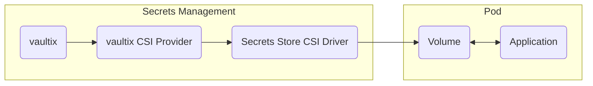

## Overview

The vaultix CSI provider allows you to use vaultix with the [Secrets Store CSI driver](https://secrets-store-csi-driver.sigs.k8s.io) to inject secrets directly into your Kubernetes pods through a volume mount.
In contrast to the [vaultix Kubernetes Operator](https://vaultix.com/docs/integrations/platforms/kubernetes), the vaultix CSI provider will allow you to sync vaultix secrets directly to pods as files, removing the need for Kubernetes secret resources.

<Tip>
  For a complete Helm chart reference including all configurable values, see the [CSI Provider Helm chart documentation](/self-hosting/helm-charts/csi-provider).
</Tip>



## Features

The following features are supported by the vaultix CSI Provider:

- Integration with Secrets Store CSI Driver for direct pod mounting
- Authentication using Kubernetes service accounts via machine identities
- Auto-syncing secrets when enabled via CSI Driver
- Configurable secret paths and file mounting locations
- Installation via Helm

## Prerequisites

The vaultix CSI provider is only supported for Kubernetes clusters with version >= 1.20.

## Limitations

Currently, the vaultix CSI provider only supports static secrets.

## Deploy to Kubernetes cluster

### Install Secrets Store CSI Driver

In order to use the vaultix CSI provider, you will first have to install the [Secrets Store CSI driver](https://secrets-store-csi-driver.sigs.k8s.io/getting-started/installation) to your cluster.

#### Standard Installation

For most Kubernetes clusters, use the following installation:

```bash
helm repo add secrets-store-csi-driver https://kubernetes-sigs.github.io/secrets-store-csi-driver/charts
```

```bash
helm install csi secrets-store-csi-driver/secrets-store-csi-driver \
--namespace=kube-system \
--set "tokenRequests[0].audience=vaultix" \
--set enableSecretRotation=true \
--set rotationPollInterval=2m \
--set "syncSecret.enabled=true" \
```

The flags configure the following:

- `tokenRequests[0].audience=vaultix`: Sets the audience value for service account token authentication (recommended for environments that support custom audiences)
- `enableSecretRotation=true`: Enables automatic secret updates from vaultix
- `rotationPollInterval=2m`: Checks for secret updates every 2 minutes
- `syncSecret.enabled=true`: Enables syncing secrets to Kubernetes secrets

<Info>
  If you do not wish to use the auto-syncing feature of the secrets store CSI
  driver, you can omit the `enableSecretRotation` and the `rotationPollInterval`
  flags. Do note that by default, secrets from vaultix are only fetched and
  mounted during pod creation. If there are any changes made to the secrets in
  vaultix, they will not propagate to the pods unless auto-syncing is enabled
  for the CSI driver.
</Info>

#### Installation for Environments Without Custom Audience Support

Some Kubernetes environments (such as AWS EKS) don't support custom audiences and will reject tokens with non-default audiences. For these environments, use this installation instead:

```bash
helm install csi secrets-store-csi-driver/secrets-store-csi-driver \
--namespace=kube-system \
--set enableSecretRotation=true \
--set rotationPollInterval=2m \
--set "syncSecret.enabled=true" \
```

<Warning>
  **Environments without custom audience support**: Do not set a custom audience
  when installing the CSI driver in environments that reject custom audiences.
  Instead, use the installation above and set `useDefaultAudience: "true"` in
  your SecretProviderClass configuration.
</Warning>

### Install vaultix CSI Provider

You would then have to install the vaultix CSI provider to your cluster.

**Install the latest vaultix Helm repository**

```bash
helm repo add vaultix-helm-charts 'https://dl.cloudsmith.io/public/vaultix/helm-charts/helm/charts/'

helm repo update
```

**Install the Helm Chart**

```bash
helm install vaultix-csi-provider vaultix-helm-charts/vaultix-csi-provider
```

For a list of all supported arguments for the helm installation, you can run the following:

```bash
helm show values vaultix-helm-charts/vaultix-csi-provider
```

### Authentication

In order for the vaultix CSI provider to pull secrets from your vaultix project, you will have to configure
a machine identity with [Kubernetes authentication](https://vaultix.com/docs/documentation/platform/identities/kubernetes-auth) configured with your cluster.
You can refer to the documentation for setting it up [here](https://vaultix.com/docs/documentation/platform/identities/kubernetes-auth#guide).

<Warning>
  **Important**: The "Allowed Audience" field in your machine identity's
  Kubernetes authentication settings must match your CSI driver installation. If
  you used the standard installation with `tokenRequests[0].audience=vaultix`,
  set the "Allowed Audience" field to `vaultix`. If you used the installation
  for environments without custom audience support, leave the "Allowed Audience"
  field empty.
</Warning>

### Creating Secret Provider Class

With the Secrets Store CSI driver and the vaultix CSI provider installed, create a Kubernetes [SecretProviderClass](https://secrets-store-csi-driver.sigs.k8s.io/concepts.html#secretproviderclass) resource to establish
the connection between the CSI driver and the vaultix CSI provider for secret retrieval. You can create as many Secret Provider Classes as needed for your cluster.

#### Standard Configuration

```yaml
apiVersion: secrets-store.csi.x-k8s.io/v1
kind: SecretProviderClass
metadata:
  name: my-vaultix-app-csi-provider
spec:
  provider: vaultix
  parameters:
    vaultixUrl: "https://app.vaultix.com"
    authMethod: "kubernetes"
    identityId: "ad2f8c67-cbe2-417a-b5eb-1339776ec0b3"
    projectId: "09eda1f8-85a3-47a9-8a6f-e27f133b2a36"
    envSlug: "prod"
    secrets: |
      - secretPath: "/"
        fileName: "dbPassword"
        secretKey: "DB_PASSWORD"
      - secretPath: "/app"
        fileName: "appSecret"
        secretKey: "APP_SECRET"
```

#### Configuration for Environments Without Custom Audience Support

For environments that don't support custom audiences (such as AWS EKS), use this configuration instead:

```yaml
apiVersion: secrets-store.csi.x-k8s.io/v1
kind: SecretProviderClass
metadata:
  name: my-vaultix-app-csi-provider
spec:
  provider: vaultix
  parameters:
    vaultixUrl: "https://app.vaultix.com"
    authMethod: "kubernetes"
    useDefaultAudience: "true"
    identityId: "ad2f8c67-cbe2-417a-b5eb-1339776ec0b3"
    projectId: "09eda1f8-85a3-47a9-8a6f-e27f133b2a36"
    envSlug: "prod"
    secrets: |
      - secretPath: "/"
        fileName: "dbPassword"
        secretKey: "DB_PASSWORD"
      - secretPath: "/app"
        fileName: "appSecret"
        secretKey: "APP_SECRET"
```

<Note>
  **Key difference**: The only change from the standard configuration is the
  addition of `useDefaultAudience: "true"`. This parameter tells the CSI
  provider to use the default Kubernetes audience instead of a custom
  "vaultix" audience, which is required for environments that reject custom
  audiences.
</Note>

<Note>
  The SecretProviderClass should be provisioned in the same namespace as the pod
  you intend to mount secrets to.
</Note>

#### Supported Parameters

<Accordion title="vaultixUrl">
  The base URL of your vaultix instance. If you're using vaultix Cloud US,
  this should be set to `https://app.vaultix.com`. If you're using vaultix
  Cloud EU, then this should be set to `https://eu.vaultix.com`.
</Accordion>

<Accordion title="caCertificate">
  The CA certificate of the vaultix instance in order to establish SSL/TLS
  when the instance uses a private or self-signed certificate. Unless necessary,
  this should be omitted.
</Accordion>

<Accordion title="authMethod">
  The auth method to use for authenticating the vaultix CSI provider with
  vaultix. For now, the only supported method is `kubernetes`.
</Accordion>

<Accordion title="identityId">
  The ID of the machine identity to use for authenticating the vaultix CSI
  provider with your vaultix organization. This should be the machine identity
  configured with Kubernetes authentication.
</Accordion>

<Accordion title="projectId">
  The project ID of the vaultix project to pull secrets from.
</Accordion>

<Accordion title="envSlug">
  The slug of the project environment to pull secrets from.
</Accordion>

<Accordion title="secrets">
  An array that defines which secrets to retrieve and how to mount them. Each
  entry requires three properties: `secretPath` and `secretKey` work together to
  identify the source secret to fetch, while `fileName` specifies the path where
  the secret's value will be mounted within the pod's filesystem.
</Accordion>

<Accordion title="audience">
  The custom audience value configured for the CSI driver. This defaults to
  `vaultix`.
</Accordion>

<Accordion title="useDefaultAudience">
  When set to `"true"`, the vaultix CSI provider will use the default
  Kubernetes audience instead of a custom audience. This is required for
  environments that don't support custom audiences (such as AWS EKS), which
  reject tokens with non-default audiences. When using this option, do not set a
  custom audience in the CSI driver installation. This defaults to `false`.
  <Note>
    When enabled, the CSI provider will dynamically create service account
    tokens on-demand using the default Kubernetes audience, rather than using
    pre-existing tokens from the CSI driver.
  </Note>
</Accordion>

### Using Secret Provider Class

A pod can use the Secret Provider Class by mounting it as a CSI volume:

```yaml
apiVersion: v1
kind: Pod
metadata:
  name: nginx-secrets-store
  labels:
    app: nginx
spec:
  containers:
    - name: nginx
      image: nginx
      volumeMounts:
        - name: secrets-store-inline
          mountPath: "/mnt/secrets-store"
          readOnly: true
  volumes:
    - name: secrets-store-inline
      csi:
        driver: secrets-store.csi.k8s.io
        readOnly: true
        volumeAttributes:
          secretProviderClass: "my-vaultix-app-csi-provider"
```

When the pod is created, the secrets are mounted as individual files in the /mnt/secrets-store directory.

### Verifying Secret Mounts

To verify your secrets are mounted correctly:

```bash
# Check pod status
kubectl get pod nginx-secrets-store

# View mounted secrets
kubectl exec -it nginx-secrets-store -- ls -l /mnt/secrets-store
```

### Troubleshooting

To troubleshoot issues with the vaultix CSI provider, refer to the logs of the vaultix CSI provider running on the same node as your pod.

```bash
kubectl logs vaultix-csi-provider-7x44t
```

You can also refer to the logs of the secrets store CSI driver. Modify the command below with the appropriate pod and namespace of your secrets store CSI driver installation.

```bash
kubectl logs csi-secrets-store-csi-driver-7h4jp -n=kube-system
```

**Common issues include:**

- Mismatch in the audience value of the CSI driver with the machine identity's Kubernetes auth configuration
- SecretProviderClass in the wrong namespace
- Invalid machine identity configuration
- Incorrect secret paths or keys

**Issues in environments without custom audience support:**

- **Token authentication failed with custom audience**: If you're seeing authentication errors in environments that don't support custom audiences (such as AWS EKS), ensure you're using the installation without custom audience and have set `useDefaultAudience: "true"` in your SecretProviderClass
- **Audience not allowed errors**: Make sure the "Allowed Audience" field is left empty in your machine identity's Kubernetes authentication configuration when using environments that don't support custom audiences

## Best Practices

For additional guidance on setting this up for your production cluster, you can refer to the Secrets Store CSI driver documentation [here](https://secrets-store-csi-driver.sigs.k8s.io/topics/best-practices).

## Frequently Asked Questions

<AccordionGroup>
  <Accordion title="Is it possible to sync vaultix secrets as environment variables?">
    Yes, but it requires an indirect approach:

    1. First enable syncing to Kubernetes secrets by setting `syncSecret.enabled=true` in the CSI driver installation
    2. Configure the Secret Provider Class to sync specific secrets to Kubernetes secrets
    3. Use the resulting Kubernetes secrets in your pod's environment variables

    This means secrets are first synced to Kubernetes secrets before they can be used as environment variables. You can find detailed examples in the [Secrets Store CSI driver documentation](https://secrets-store-csi-driver.sigs.k8s.io/topics/set-as-env-var).

  </Accordion>
</AccordionGroup>

<AccordionGroup>
  <Accordion title="Do I have to list out every vaultix single secret that I want to sync?">
    Yes, you will need to explicitly list each secret you want to sync in the
    Secret Provider Class configuration. This is a common requirement across all
    CSI providers as the Secrets Store CSI Driver architecture requires specific
    mapping of secrets to their mounted file locations.
  </Accordion>
</AccordionGroup>
