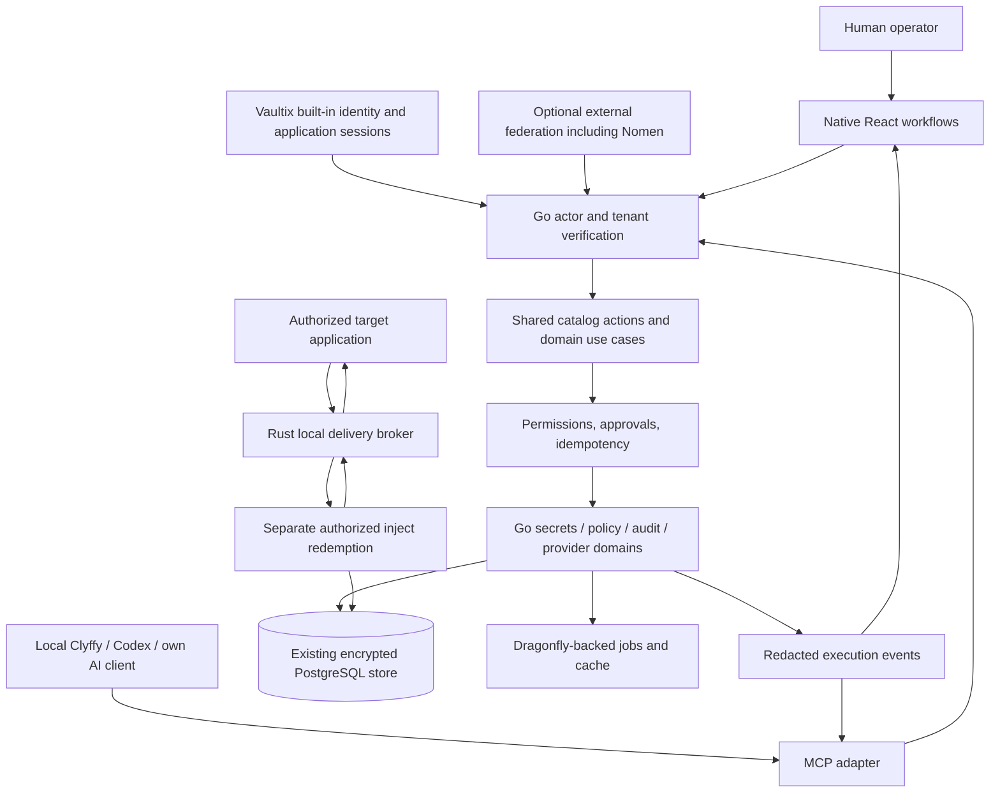

# ADR-0027: Native Vaultix architecture and migration sequence

**Status:** Accepted target direction; implementation is incomplete.
**Date:** 2026-10-27. **Owner:** AngryVibes LLC.
**Product:** Vaultix.cloud; DevSCIF.com uses tailored deployment/control profiles.

## Decision and constraints

Author the existing product in place as native React workflows, Go domain
services, and focused Rust runtime components. Migrate complete use cases,
including data access and authorization, rather than leaving a Go facade over
permanent TypeScript business logic. Keep one encrypted PostgreSQL store and
the current application entry. Preserve existing capabilities while each domain
changes implementation. No replacement help/demo viewport or second vault.

This is an implementation program, not a claim that a technology migration has
already happened. Every product-owned module remains subject to [0021](0021-product-authorship-review.md).
Reviewed correct logic can be retained with a reason; generated and third-party
code keeps its provenance. No mass string substitution, arbitrary deletion, or
removal of features to make the new implementation easier to ship.

The sequence remains Auth (built-in and federated) → Secrets (Vaultix).
The owner's [2026-10-30 identity correction](0074-built-in-and-federated-identity.md)
requires independent built-in operation and optional external federation, with
one existing account/membership model and encrypted store. Nomen is not a
prerequisite for built-in accounts, MFA, recovery, sessions or machine identity.
Existing secrets-related gateway/PAM adapters are in scope; starting Zuul/Mesh work requires the separate
scope decision. No Nomen/Zuul runtime imports or `nomen_vault_*` tables.

## Observed starting point

| Existing code | Observed role | Destination |
| --- | --- | --- |
| `core/frontend` | React 18.3.1, TypeScript 5.6.3, Vite 6.4.2 in the lockfile; native full application with inherited and authored workflows | React/TypeScript native application, upgraded with library compatibility and real browser evidence |
| `core/backend/src/services` and `ee/services` | Substantial TypeScript domain logic, DALs, jobs, auth and APIs | Go domain packages, migrated by complete use case with temporary compatibility routing |
| `core/backend-go/internal` | Existing auth/permission, secret reading/imports, KMS/HSM, queues and server infrastructure | Expand and reconcile this Go engine; do not create a third backend |
| `cmd/vaultix`, `internal` | Go CLI, local encrypted store, sync, child-process environment injection | Go client UX; Rust application-delivery boundary after explicit protocol and OS acceptance |
| `core/wasm/ironrdp-decoder` | Rust 2021 WASM decoder | Reviewed Rust protocol component; edition/toolchain upgrade separately verified |
| `panel` and `web` | Optional historical panel/source/viewport paths | Trace every remaining capability, implement equivalent native behavior, then retire redundant paths explicitly |
| PostgreSQL migrations, encrypted records, provider credentials | Existing persisted state and operational integration | Compatible schema and ciphertext; no dump replacement or new parallel secrets store |
| Dragonfly / Redis-protocol clients | BullMQ and Go queue/cache dependencies | Dragonfly default, explicit Redis/ElastiCache; queue compatibility must be demonstrated |

Existing CLI `internal/cli/run_cmds.go` permits an arbitrary child command and
falls back to a local secret copy on sync failure. It is **not** a safe AI
injection boundary. Current Clyffy instructions prohibit injecting into the agent;
an instruction is not enforcement. Migrating this behavior requires explicit
online/offline policy and target-workload verification before AI-managed delivery.

## Target boundaries

The diagram is the target, not the current topology. The model receives references
and redacted execution state; it is not on the value-delivery path.

### React: actual product workflows

Keep `core/frontend`, its route continuity and real service integration. Upgrade
React and React DOM together; verify router/query, Radix, editors, forms, tables,
charts, replay components and test tooling before removing compatibility code.
Use strict typed contracts, explicit async states and accessible native controls.
Keep server state in the existing query layer; do not duplicate it in an AI store.
No new Zod in authored product TypeScript. Use versioned JSON Schema contracts
and generated types with a tested runtime validator, selected and pinned in the
contract implementation slice. Never cast untrusted input into a trusted type.

Rewrite entire workflows: entry/setup, projects/environments, editing/imports,
approvals, rotation/sync, identities, audit, PKI, PAM, KMS and organization/admin
settings. Preserve all controls and role-specific paths. Apply WCAG 2.2 AA,
keyboard and real screen-reader acceptance, reflow, focus recovery and reduced
motion. Shared components need consuming-workflow tests.

Catalog entries define supported controls, action IDs and teaching content.
React owns the rendering and accessibility. A2UI events select versioned,
allowlisted native components and actions; they cannot supply arbitrary HTML,
JavaScript, URLs, selectors or new authority. Existing routes are converted
incrementally rather than hidden inside a generic generated viewport. Tooltips,
dialogs and user-paced guidance share the same authored content. Remotion output
is optional educational media, never evidence that an operation succeeded.

### Go: primary business and authorization boundary

Build on `core/backend-go/internal/services` and its server infrastructure.
Each domain owns its use cases, authorization, repository interfaces, validation
and operational errors. HTTP, MCP and jobs call those same use cases. They do not
reimplement policy or trust actor/tenant IDs supplied by a model.

Pass `context.Context` deadlines/cancellation through network and database work;
bound concurrency, pagination and result sizes. Use short transactions with one
transaction handle throughout. Keep network calls and expensive cryptography
outside transactions; commit durable outbox intent with the state change, then
dispatch after commit. Use structured redacted logs and plain `error` strings
for expected API failures. New GETs are safe and metadata-only. Existing raw-value
compatibility endpoints stay outside the AI action catalog pending migration.

Retain provider SDKs and established cryptographic libraries unless evidence
requires replacement. No new cryptographic algorithms. Test permission parity,
race conditions, cancellation, pool exhaustion, fuzzed inputs and outage recovery.
Run Go tests, race detection on supported runners, vet and vulnerability scanning.

### Rust: tightly scoped value delivery and protocol isolation

Use Rust for the target-process delivery broker and existing/bounded protocol
decoding work where memory and process isolation matter. Proposed new broker code
belongs under `core/runtime/` after its protocol review; it does not exist yet.
Keep business policy and durable state in Go. Use a versioned process boundary
rather than broad in-process FFI. Do not port all services to Rust merely to use
three languages.

Pin the stable toolchain, MSRV and target matrix. Prefer safe Rust, explicit error
types, bounded inputs, reviewed dependencies and narrowly reviewed `unsafe`.
Use formatting, Clippy, tests, fuzzing of protocol parsers and platform lifecycle
tests. Zeroization is defense in depth, not a claim that OS/process memory cannot
leak. Disable secret-bearing logs and crash artifacts at this boundary. Preserve
the existing cipher format and key recovery until verified replacement is ready.

## Version policy and current verified references

On 2026-10-27 the official pages list React **19.3**, Go **1.27.3**, and Rust
**1.99.1**. These are planning targets, not installed-version claims. React's
upgrade guide describes breaking changes; Rust 2024 is a separate edition
migration. Recheck patch releases at implementation time, pin versions and
lockfiles, and run the compatibility matrix before promotion.

- [React versions](https://react.dev/versions) and [React 19 upgrade guide](https://react.dev/blog/2024/04/25/react-19-upgrade-guide).
- [Go releases and support policy](https://go.dev/doc/devel/release) and [Go security practices](https://go.dev/doc/security/best-practices).
- [Rust releases](https://doc.rust-lang.org/releases.html) and [Rust 2024 edition](https://doc.rust-lang.org/edition-guide/rust-2024/index.html).

The root Go module/CI currently use 1.27.2, while panel/sidecar module directives
are older. Prioritize the supported Go security patch and reconcile toolchain
selection before larger ports. Treat React, Go and Rust upgrades as separate
reviewable changes. TypeScript, Vite, Node, npm and provider dependency versions
need their own compatibility/security check; do not label them current by
association. The known npm/optional-QUIC dependency constraint remains a specific
delivery task. No global tooling changes are needed for this plan.

## AI-managed secrets: required execution contract

AI manages lifecycle **intent**, references and approved automation. Vaultix and
the target workload handle values. Codex's local ChatGPT sign-in provides model
access; Vaultix authentication uses its separate built-in or federated flow.
No subscription-password collection, token copying or shared identity session. Own-provider configurations
remain in the user's client. Official [Codex authentication](https://developers.openai.com/codex/auth)
and [MCP configuration](https://developers.openai.com/codex/mcp) document these
distinct sign-in and server-authentication capabilities; actual Nomen/Codex
interoperability still needs a registered client and tests.

Every mutating source action must carry a versioned action ID, bounded metadata
inputs, resource scope/version, idempotency key and client correlation ID. The
server derives actor and tenant from verified authentication. The registry
declares permission requirements, approval/step-up policy, input/output schemas,
allowed destinations, redaction and compensation behavior. Human UI, CLI and MCP
use the same contract and use case. Model instructions cannot add a capability.

Execution states: `proposed → validated → awaiting-approval → queued → running →
succeeded | failed | cancelled | expired`. Read-only/preapproved actions may omit
the approval state according to policy. The server binds approval to the exact
actor, scope, parameter digest and resource version, then rechecks authorization
at execution. Policy or target changes invalidate stale approval. Durable,
redacted receipts establish outcomes; narration, lesson completion and animation
never establish success. Retried calls resolve to the same operation. Cancellation
cannot promise reversal after an irreversible provider action; report the actual
partial outcome and compensating work.

| AI task | Allowed model-visible inputs/results | Value handling and acceptance |
| --- | --- | --- |
| Discover/configure an application | Project/environment IDs, reference names, validated configuration manifest | No values/comments/custom metadata; unknown components/targets refuse |
| Create projects/environments/policies | Bounded names, policy intent, resource versions | Existing authorization, approvals and audit; negative/cross-tenant cases |
| Add or generate a secret | Reference name and generation policy; completion receipt | Human protected entry or server/provider generation; no value in tool input/output |
| Import provider credentials | Approved connection/reference IDs and import plan | Direct authenticated service transfer; model never uploads/reads secret files |
| Rotate, revoke or synchronize | Versioned references, destination IDs, timing policy | Provider-side execution, retries/reconciliation and redacted per-target results |
| Deliver to an application | Application/workload ID, environment, required reference set | Separate workload-authenticated single-use redemption; no redeem credential returned to the model |
| Explain/debug failure | Error code, resource IDs, safe status and recovery steps | No raw request bodies, headers, environment dumps, provider responses or terminal secret output |

Application delivery must bind a registered launch manifest, executable identity,
OS principal/workload identity, destination, TTL and one-time nonce. A model-chosen
PID or command basename is insufficient. The broker must reject agent/assistant
processes, arbitrary shells, replay, expired/revoked grants and cross-tenant or
wrong-target redemption. The workload obtains delivery authority outside MCP.
Use protected IPC/child handles for delivery; environment injection, if required
by a workload, is explicit and target-only. No parent AI environment mutation.
Test Windows, Linux and macOS; do not assume Unix mode bits secure Windows files.

Treat repository text, imported metadata and provider responses as untrusted.
Test prompt injection attempting to change actor, tenant, approval, destination,
secret exposure or tool definitions. Redaction must be exercised with planted
canary values across logs, traces, exceptions, UI events, MCP results and screenshots.

## Migration waves and exit gates

The machine-readable dependency graph is [workstreams.json](migration/workstreams.json).
The generated file/module maps are discovery aids, not completed reviews.

| Wave | Concrete deliverable | Required evidence before cutover |
| --- | --- | --- |
| 0: characterize | Reconcile ownership map, unsupported/deprecated behavior, API response/schema fixtures, encrypted DB snapshots from disposable fixtures, queue payloads and existing test gaps | Every selected module fully read; route preservation plus behavior matrix; no blank unknowns silently marked done |
| 1: foundations and identity | Supported toolchains; Go contract/validation/error conventions; Built-in and federated actor/tenant mapping; canonical product configuration | Independent built-in operation, combined method enforcement, provider-specific issuer/audience/expiry/logout/revocation, cross-tenant denial, existing-login migration and tested rollback |
| 2: first complete Go slice | Project/environment/reference reading in existing Go services; native React UI and MCP use the same domain behavior | Old/new differential tests on deterministic fixture data, pagination/import/role semantics, real UI, no value exposure, latency baseline |
| 3: lifecycle and actions | Create/update/version/restore/delete, approval binding, idempotency, audit/outbox, source-action execution history | Positive/denied/conflict/concurrent/failure/cancel paths; encrypted restore; same human/AI authorization |
| 4: application delivery | Rust broker plus Go CLI integration, target-only redemption, generation/import connection workflows | Real target app consumes a canary; agent never sees it; replay/expiry/revocation/wrong-process denial on supported OSes |
| 5: automation/providers | Rotation, leases, sync, event delivery, provider adapters; explicit BullMQ-to-Go queue transition | Provider-specific success/failure/recovery, durable retries, exactly one writer/consumer ownership, duplicate-delivery safety |
| 6: complete security domains | Audit/export, KMS/HSM/KMIP, PKI/signing, PAM/replay, scanning/honeytokens, all enterprise administration | Per-provider/hardware/protocol proofs and full native workflows; unavailable prerequisites remain blocked |
| 7: hosted/DevSCIF profiles | Hosted Vaultix rollout first; suite control profiles and operator boundaries | Backup/restore, load/failover, disaster recovery, artifact provenance, tenant/operator separation and explicit deployment requirements |
| 8: retirement | Remove replaced TypeScript domains and optional panel paths after compatibility windows | No remaining callers, verified equivalent workflows, migrated data/jobs, documented rollback boundary and operator migration |

UI conversion proceeds with each domain wave and shared UI foundations; it is not
deferred until the last backend port. Actual staffing dates and throughput cannot
be inferred from file counts. Wave exit is evidence-based, not calendar-based.

### First implementation packages

1. **STACK-01:** reconcile Go build/CI/module toolchains to a supported security
   patch; prove root CLI, sidecar, panel and canonical image. Inventory React 19
   peer incompatibilities and Rust toolchain/MSRV independently.
2. **AUTH-01:** trace `core/backend-go/internal/services/auth` and `permission`,
   current TS middleware, and native route authentication. Preserve built-in
   credentials, factors, recovery and sessions while specifying optional federation
   and shared actor/organization mapping. Follow IDENTITY-01..06 in 0074; retain
   real issuer acceptance for each provider without making it a built-in dependency.
3. **READ-01:** fully read `services/vaultix/reference-service.ts`, its DAL and
   router, existing Go project/secretmanager/permission services and callers.
   Author Go metadata queries against the existing store. Differential tests must
   cover permission-filtered empty pages, imports, tenant scopes and missing IDs.
4. **ACTION-01:** author the shared action schema, registry and execution ledger
   in Go with JSON Schema-derived TS types. Prove contract round trips before
   migrating the first project/environment mutation. No AI mutation exposure
   until its approval, denial, audit and recovery tests pass.
5. **INJECT-01:** read all Go CLI/store/sync callers, define offline behavior and
   workload binding, then implement the Rust broker. Prove actual target delivery
   with secret canaries before offering AI-managed injection.

## Cutover, persistence and rollback rules

For each use case: characterize → author → compare → stage → switch ownership →
observe → retire. A temporary compatibility route may delegate to the new domain;
the completed domain must own real behavior and data access. Do not mark a proxy
to old TS business code as a completed Go migration.

Use additive schema changes and a single migration owner. Compare Go/TS crypto
against known-answer vectors, existing envelope formats, key IDs and rotation
history. No bulk re-encryption merely for a language change. Migrate in bounded
restartable batches with counts, checksums and encrypted backup/restore rehearsal.
Keep the old binary compatible during the rollback window; destructive schema
contraction waits until that window ends. Never dual-write secrets as an informal
consistency strategy. Shadow comparisons use isolated fixture data or safe metadata,
not duplicated live value reads/rotations/provider effects.

BullMQ and Go Asynq are not interchangeable because both use Redis. Inventory
job payloads, locks, retries and leases; drain or translate durably, fence consumer
ownership, reconcile in-flight provider effects, and test restart at every boundary.
Keep Dragonfly default; test Redis and real ElastiCache TLS/ACL/failover separately.

## Completion definition and unresolved inputs

A module needs an exact-content review, caller/data/auth trace, authored target
implementation, migration consequences, positive and denial/failure/recovery
evidence, native UI acceptance and recorded operational prerequisites. A workflow
needs the entire path, not just an enabled feature or compiled route. Retain
[0026](0026-capability-preservation.md) gates; expand them to response schemas,
cryptographic compatibility and behavioral parity as each domain moves.

Set service-level budgets from measured workloads before load cutover: secret and
tenant counts, batch sizes, p95/p99 latency, job throughput, memory, backup RPO/RTO,
provider limits and deployment failure domains. Those numbers are not yet supplied
or measured. WI/TX deployment targets, Nomen client/issuer details, real provider
accounts/HSM hardware and DevSCIF control requirements remain explicit inputs.
They block their deployment tests, not source mapping and local implementation.
No government certification, classified suitability or enterprise parity claim
follows from a domain name or this plan.

## Alternatives and consequences

| Option | Benefits | Costs / decision |
| --- | --- | --- |
| Permanent TS backend with new branding | Lowest short-term migration risk | Does not meet the requested Go/Rust ownership direction; rejected as end state |
| Immediate all-at-once Go/Rust rewrite | Uniform target language sooner | Unbounded behavioral/data/provider risk and rollback difficulty; rejected |
| Domain-by-domain native migration | Reviewable ownership, preserved capabilities, real rollback windows | Temporary mixed runtime and explicit compatibility work; selected |
| Rust for every service | One systems language | Adds migration cost without demonstrating a domain benefit; reserve Rust for justified boundaries |

Three languages create tooling and contract-maintenance costs. Shared versioned
contracts, generated clients, reproducible builds and one domain implementation
per migrated use case are required to keep that cost bounded. AI compatibility
comes from these contracts, permissions and observable workflows; a language
choice alone does not make secret management safe or understandable to an agent.
