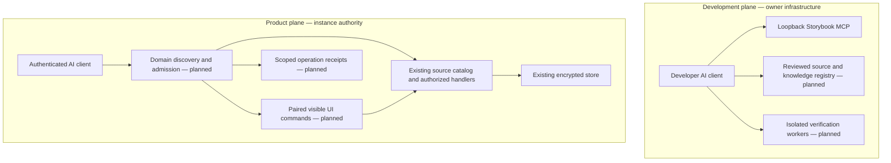

# Separate domain MCP mesh and the UI workbench

Owner: AngryVibes LLC. Product: Vaultix.cloud. Suite: DevSCIF.com.
Research date: 2026-11-06. Status: architecture and first UI workbench increment;
**customer mesh execution and a complete UI rebuild remain unaccepted**.

This extends [0114](0114-domain-scripted-ui-standard.md) and
[0115](0115-mesh-knowledge-personas-and-scripted-event-benchmark.md). The owner
explicitly requested separate mesh design. The default design has two isolated
planes: development and product. This does not change Auth → Secrets → Mesh
implementation order, import another product runtime, or establish cloud readiness.

## Evidence and what it supports

Primary sources checked on the research date:

| Evidence | Finding and limit | Decision for Vaultix |
| --- | --- | --- |
| [Microsoft: three developer field experiments](https://www.microsoft.com/en-us/research/publication/the-effects-of-generative-ai-on-high-skilled-work-evidence-from-three-field-experiments-with-software-developers/) | Across 4,867 developers, access to coding assistance increased completed tasks by an estimated 26.08% (SE 10.3%). These were coding-assistant trials, not a test of an MCP mesh. | Measure accepted tasks and downstream rework, not generated lines or agent count. |
| [METR, February 2026 update](https://metr.org/blog/2026-02-24-uplift-update/) | Later results suggest possible speedup, but selection effects and time accounting make the estimates unreliable. The authors do not establish a general productivity gain. | Include review, waiting, failed attempts and parallel-worker time; do not market a universal multiplier. |
| [Anthropic: advanced tool use](https://www.anthropic.com/research/advanced-tool-use) | Internal evaluations report improved tool selection with on-demand discovery; their programmatic-calling examples reduce intermediate context. These are vendor evaluations and specific workloads. | Discover domain summaries first, load only relevant schemas, return bounded receipts. Benchmark the extra discovery latency. |
| [Anthropic: multi-agent research](https://www.anthropic.com/engineering/multi-agent-research-system) | A lead/subagent system improved an internal research evaluation, but the authors explicitly distinguish coding's weaker parallelism. | Default to one accountable executor. Delegate independent tasks only with ownership and an integration budget; a mesh is not an automatic agent swarm. |
| [MCP 2026-07-28 changes](https://modelcontextprotocol.io/specification/2026-07-28/changelog) | Stateless requests, per-request version/capabilities and discovery replace earlier transport lifecycle assumptions. | Version protocol adapters explicitly. Keep existing 2025-11-25 behavior until both client paths pass acceptance. |
| [Storybook MCP](https://storybook.js.org/docs/ai/mcp/overview) and [interaction tests](https://storybook.js.org/docs/writing-tests/interaction-testing) | Component manifests, documentation discovery and test tools can connect the actual design system to an AI client. The AI integration is preview software. | Install a pinned local developer MCP and test it; do not expose it as a customer service. |
| [Playwright actionability](https://playwright.dev/docs/actionability) | Visible, stable, enabled targets and observed outcomes matter even with reliable selectors. | Named commands retain readiness and outcome checks. Fewer screenshots must not remove those guarantees. |

These sources justify an experiment and architecture choices. They do not prove
Vaultix savings, production scale or superiority to browser automation. The paired
benchmark in 0114 remains required, including cold setup, failures, token accounting,
CPU/RSS and takeover delay. The 25% warm-token target is a hypothesis, not a result.

## Two isolated planes

MCP is a client/server protocol, not a peer-routing or identity mesh by itself.
Vaultix must supply registration, admission, routing, budgets and receipts around
the existing source catalog. “Separate” means separate processes, identities,
network policy, discovery caches and audit streams, not a different secrets store.

There is no development-to-production execution edge. Development workers receive
fixture data and a checkout; they do not inherit customer sessions, deployment keys,
release signing keys or production secret mounts. Production tool results cannot
be promoted into development instructions. Reviewed source artifacts may be shipped
through the normal signed release process; that is not runtime credential sharing.

Initial deployment needs no new cluster: loopback Storybook on the workstation,
isolated test containers on owned hardware, existing instance services. Product
mesh admission and workers remain disabled until their gates pass. Later networked
workers require distinct service accounts, authenticated encrypted transport,
default-deny ingress/egress, tenant quotas and revocation tests. A shared Docker
network or a list of URLs alone does not implement these boundaries.

## Domain ownership and designated MCP surfaces

Canonical domain IDs come from `docs/interaction/workflows.json`; business capability
ownership comes from `docs/capabilities/catalog.mjs`. A domain owns one reviewed
tool/resource namespace. It does not need its own process until scale or authority
requires isolation. Discovery references existing source action IDs; no second API
reimplements authorization. No new domain endpoint below is live in this packet.

| Domain | Knowledge/engram responsibility | Product action boundary | UI conversion owner |
| --- | --- | --- | --- |
| public | Product explanation, early access, sample rehearsal | Public metadata; explicit abuse-controlled early-access submission | Landing and public rehearsal |
| auth | Built-in/federated sign-in, recovery, device approval | Human-only credentials/consent; no password/MFA tool inputs | Login, setup, MFA and recovery |
| workspace | Organizations, projects, environment orientation | Current membership and selected organization | Organization layout and project cards |
| secrets | References, folders, environment selection, lifecycle | Metadata to AI; values only through authorized injection redemption | Secrets workspace and references |
| access | Identities, memberships, role/permission policy | Source permission and assurance checks; exact mutation review | Access control and machine identities |
| automation | Rotation, jobs, approvals | Bounded jobs, source idempotency and outcome reconciliation | Job and approval workflows |
| connect | Integrations and synchronization | Provider-scoped credentials remain outside model context | Connection setup and health |
| pki | Authorities, issuance, certificate lifecycle | Existing issuance policy and project authority | Certificate Manager |
| kms | Key use and lifecycle | No private key material in guidance/results | Key management |
| pam | Privileged account/session policies | Approval, expiry, audited access; no borrowed browser privileges | Privileged Access Manager |
| detect | Scanning, findings, remediation | Redacted findings and authorized remediation | Secret scanning |
| ai | Client setup and reference-safe assistance | Local client identity; no collection of Codex subscription credentials | Connection and assist surfaces |
| governance | Audit, retention, policy evidence | Scoped metadata export and recorded review | Audit and policy views |
| operate | Instance health, backups, upgrades, rollback | Instance administrator authority; restore rehearsal before replacement | Server Console/platform services |
| experience | Accessible guidance, catalogs and receipts | Presentation only; never escalates another domain's authority | Shared v3 controls and assist host |

The `mesh` value allowed in the persona scaffold is infrastructure expertise, not
a sixteenth business action domain or a universal permission. Storybook's developer
tools belong to the development plane's experience work; their upstream tool names
are not renamed into customer `vaultix.ui.*` commands.

Domain summaries should fit a bounded discovery response; detailed schemas are
retrieved on demand using negotiated MCP resources/tools. Do not add a nonstandard
`domain` argument to `tools/list`, expose arbitrary endpoint URLs, or cache private
discovery across actors/tenants. Register a fixed server identity, owner, protocol
versions, artifact digest and health policy before admitting a service. Tool
descriptions and external resource text remain untrusted data.

## Engrams: reviewed knowledge, not ambient authority

For this architecture, an engram is a versioned domain knowledge package: canonical
source references, reviewed guidance, allowed action IDs, failure recovery and
evaluation fixtures. A persona selects and presents that package. Neither grants
permissions or represents an always-running agent. Keep the existing persona and
trigger v1 contracts as scaffolds; do not silently add fields or claim their sample
event IDs are registered actions.

Before runtime admission, publish a v2 contract with content digest, source commit,
domain/plane/tenant visibility, owner/reviewer, reviewed-at and expiry, supported
catalog versions, supersession and revocation. The registry must join every allowed
action to the actual catalog and reject unknown/cross-domain IDs. Existing example
auth events are illustrative, not live bindings. Migration preserves v1 originals
and requires explicit review; v1 must never acquire new authority by default.

Lifecycle: draft → source-linked review → evaluation → admitted immutable version
→ expired/revoked. Retrieval is authorization-filtered before ranking; cache keys
include actor, tenant, policy and catalog revision. Deny stale or unsigned/unapproved
packages. Semantic search can rank eligible packages but cannot select tools outside
the allowlist. No secrets, raw credential forms or unrestricted conversation dumps
enter the package. Feedback produces a review proposal, never self-edits policy.

Knowledge drops use bounded event facts and authored text, explicit suppression,
deduplication, reduced-motion and an off switch. Label them “Vaultix guidance” so
authored facts are not misrepresented as live AI reasoning. Passive drops neither
steal focus nor open modals. User-requested help opens a dialog with focus return.

## Execution and protocol gates

Keep source calls and visible UI control distinct: a headless source read needs no
browser. A teaching action requires a human-selected, paired viewport bound to the
same actor, tenant, policy, generation and catalog digest. A machine identity cannot
borrow a human browser's permissions. Effective access intersects both identities.

Authored finite workflows call the same React/domain handlers as human controls.
Every step rechecks mounted scope, readiness, authority and cancellation. A cosmetic
cursor/highlight is optional teaching presentation, never proof of a trusted input
or business completion. Inputs cannot contain arbitrary JavaScript, selectors,
HTML or URLs. Credential fields remain human-only. Changed review inputs invalidate
consent. Source receipts, viewport acknowledgement and teaching completion are
separate outcomes; lost mutation replies require reconciliation, not blind retry.

Per-tenant quotas bound queue length, payload size, running tasks and result retention.
Product admission fails closed on policy/cache failure. Dragonfly is the default
shared lease/revocation store; Redis and ElastiCache need separate compatibility
evidence. Store durable idempotency with the source mutation, not in a browser tab.
Trace request IDs and redacted outcomes, not secret values. Test two replicas,
revocation, expired leases, duplicate delivery, restart and human takeover.

The current backend adapter in `core/backend/src/services/vaultix/mcp.ts` supports
versions through 2025-11-25. Research found that 2026-07-28 removes the initialize
handshake and transport session IDs. A dedicated compatibility packet must test
`server/discover`, per-request negotiation, result envelopes, subscriptions and
retry behavior against actual clients. Transport statelessness does not eliminate
application pairing/approval leases. Never advertise the new version merely by
changing a constant. Storybook's own negotiated protocol is independent.

## Whole-UI rebuild sequence and acceptance

Convert complete workflows in place. Keep navigation, permissions, loading/error,
setup/access-request branches and existing store behavior. Storybook isolates real
components for design and testing; it is not a second application viewport.

| Packet | Work | Acceptance before promotion |
| --- | --- | --- |
| W0: workbench | Pinned Storybook, local developer MCP, real product-card interactions and contextual help | Static build; developer tool discovery; keyboard help/denial; narrow view and selected-state axe checks. This is the current increment. |
| W1: shell | Review all existing layouts and sidebar routes; consistent scope/header, responsive navigation, reserved status/assist area, skip links and focus restoration | Every existing route/capability reachable; real login/project transitions; 320 CSS px/400% zoom; keyboard and screen reader; cold/warm performance comparison. |
| W2: Auth → Secrets | Full built-in/federated/account lifecycle, project/environment/folder flows, source reads and failures | Packaged CLI/browser identity and tenant isolation; complete workflow stories; real persisted state checks; no provider acceptance from fixtures. |
| W3: local events | Catalog-bound help/teaching, shared handlers, bounded knowledge triggers and receipt display | Trigger suppression/replay tests; no passive focus theft; cancellation, error/retry and reduced-motion; no remote-ready ledger entries yet. |
| W4: product mesh | Versioned admission, scoped discovery, paired visible references, reviewed engram registry | Actual named AI client + browser; denial, stale/cross-tenant, two replicas, takeover and reconciliation; paired benchmark with failures included. |
| W5: domain expansion | Access/automation/connect, then pki/kms/pam/detect, governance/operate | Per-domain before/after capability ledger, real-service regression and manual accessibility; cloud durability/quotas/capacity gates stay independent. |

Performance gates: record compressed initial JS/CSS, route chunks, requests, LCP/INP
and idle CPU on a fixed device/network profile for public, login, projects and
secrets routes. Compare to the prior accepted artifact; predeclare numeric budgets
after collecting that baseline. No unmeasured “fast” claim. Keep Storybook/Vitest/MCP
developer dependencies out of production imports, defer media and heavy editors,
use vector/CSS depth and respect motion preferences. A tooltip everywhere is not
the goal: essential labels/status stay visible; tooltips provide secondary detail.

Current card event attributes remain locator metadata. Contextual dialogs do not
complete W3/W4, register remote commands or prove MCP Apps client rendering. The
existing action ledger remains partial. Full manual accessibility, live providers,
cloud load testing and whole-product capability parity remain separate evidence.

## Workbench operation

From `core/frontend`, use `npm ci`, then `npm run storybook`. It binds to
`127.0.0.1:6006`; its developer MCP endpoint is `http://127.0.0.1:6006/mcp`.
Configure the developer client with that URL, without customer tokens. Keep the
server local; remote access needs a separately reviewed authenticated tunnel and
host/origin policy, not `0.0.0.0` or permissive CORS. Stop the process when finished.

`npm run build-storybook` builds a static review artifact. From the repository root,
`node scripts/build-storybook.mjs` produces the isolated acceptance artifact under
`.cache/storybook-workbench` using the pinned package's executable and correct cwd.
`npm run test:stories`
executes browser interaction tests using the local Vitest/Playwright installation.
On Windows, the embedded MCP/UI test runner reproduced
[upstream issue #35864](https://github.com/storybookjs/storybook/issues/35864)
(UniversalStore follower startup timeout). The MCP test tool is deliberately not
advertised on Windows; documentation and preview tools remain enabled and the same
interaction tests run through the local CLI. Linux embedded execution must pass
its own acceptance before being claimed. This limitation does not disable tests
or change their assertions.
New product-card stories enforce accessibility checks; inherited stories still
carry the existing `todo` setting and must be reviewed incrementally, not advertised
as conformant. `scripts/test-domain-workbench.mjs` independently checks the built
artifact and `scripts/test-storybook-mcp.mjs` checks the local developer endpoint.
Neither measures model token savings or production mesh behavior.

Storybook 10.6.5 is pinned with matching addons. Registry metadata showed 10.6.6
published November 5, so it was excluded by the repository's seven-day dependency
age policy. Retain the lockfile and retest the MCP preview API before future upgrades.
