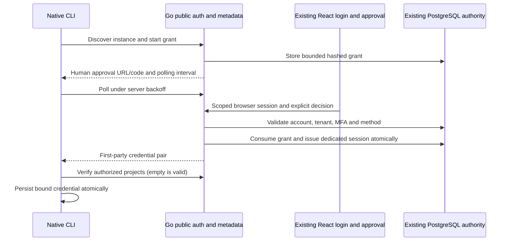

# Vaultix delivery implementation specification

This is the implementation detail for [0075](../0075-usable-secrets-and-update-delivery.md),
not another roadmap or a completion report. Baseline: `a173ee48`, 2026-11-01.
The [acceptance matrix](acceptance.md) defines independent expected outcomes.
The existing migration/capability catalogs continue to own the broader product.

### Concurrent source change: prerequisite repair

While this specification was being written, `85361217` landed on `main`. It must
be reviewed before implementation or a new artifact is accepted. A targeted
`go test ./internal/cli -run '^TestCommandName$' -count=1` on that source fails:
`internal/cli/login_mode_test.go:29:3: missing key in map literal`.
`scripts/test-cli-delivery.mjs` and `scripts/test-cli-headless.mjs` now require
Vaultix help text while also rejecting `/vaultix/i`; the brand scanner likewise
searches for the intended product name as a forbidden token. Dependency aliases,
Go checksum module identities and a third-party provenance statement also changed.
Their renamed upstream identifiers are not established by the earlier build proof.

P00 repairs the actual test intent and validates dependency/provenance identities
against verified source before any blanket rebranding. Preserve the commit and
operator work; do not force-push or automatically revert unrelated edits. Keep
genuine third-party attribution and retired-brand rejection tests distinct from
public product naming. Record these failures and stale authorship/map entries
open. The previously verified image at runtime revision `99c85ac9` does not attest
the changed dependencies in `85361217`. This specification changes documentation
only and does not deploy that commit.

## Decisions and source findings

| Source owner | Observed behavior | Implementation consequence |
| --- | --- | --- |
| `core/backend-go/internal/services/auth/device/service.go` and `types.go` | Start, inspect, approve, deny, cancel, poll and cleanup exist; first-party client/scope, database time and transactional one-use consumption are explicit | Compose these owners; do not write another grant store or issuer |
| `core/backend-go/internal/services/auth/device/access.go`, `apiauth/device_access.go` | Dedicated device validator hydrates current actor from canonical accounts/session/tenant policy | Use this validator on all selected resource routes; no unsigned actor headers or browser-token relabeling |
| `core/backend-go/internal/server/api/platform_services.go` | Optional device access verifier is constructed; grant/session issuer is not exposed by this composition | Add grant/session dependencies and lifecycle alongside existing services |
| `core/backend-go/internal/services/secretmanager/reference/reference.go` | Metadata-only SQL/permission service exists; `authenticatedActor` permits browser JWT and machine identity only | Explicit device-mode admission after verification, with unchanged permission evaluation |
| `core/backend-go/internal/services/secretmanager/reference/projects.go` | Direct/group project/environment discovery exists | Mount and compare against existing UI/MCP contract, including empty membership and filtered pages |
| `core/backend/src/server/plugins/go-sidecar-forwarding.ts` and `routes/index.ts` | Forwarding plugin lists selected secret reads, but registration is commented out; shadowing has separate activation | Presence of native code does not mean public ownership. Add exact method/path routing and prove it through the public image port |
| `core/backend/src/services/vaultix/reference-service.ts` and `vaultix-router.ts` | Existing authenticated HTTP/MCP actions use TS reference service; current negotiated Apps behavior also lives here | Keep public contracts; move the complete selected source-action/transport slice to Go with differential tests before cutover |
| `internal/cli/auth_cmds.go`, `session.go` | Terminal defaults to Nomen; renewal recognizes only `nomen`; token/universal compatibility exists | Add explicit first-party credential profile and instance discovery; preserve existing saved profiles and explicit external flow |
| `internal/api/client.go` | Authentication uses `/api/v1/vaultix/projects`; project slug lookup uses `/api/v2/workspace/:slug` | New session must work on actual metadata path; resolve selected project through authorized discovery without assuming legacy route admission |
| `internal/cli/config.go`, `run_cmds.go`, `internal/api/secrets.go` | Local cache names omit instance/actor; automatic fallback follows any sync error; compatibility GET returns values | Add scope isolation and denial-aware delivery policy; existing compatibility is not the target-only AI boundary |
| `core/frontend/src/pages/auth/CliRedirectPage/CliRedirectPage.tsx` | Old browser handoff displays a copyable bearer token | Preserve old compatibility until deliberate retirement; do not use it for new device approval |
| `contracts/vaultix.core.v1.json` | Metadata paths exist, but MCP description still says stateless and omits negotiated resource/session changes | Reconcile shipped contract before additive auth changes; do not generate a new incompatible model API |
| `contracts/vaultix.updates.v1.json`, `internal/release/release.go` | Update status checks stable release metadata, not downloadable signed artifact readiness | Add a separate artifact manifest contract; preserve status v1 readers or explicitly version incompatible changes |

These findings are scoped reads and traces, not an assertion that all linked
domain files were reviewed. Before implementation, read complete affected modules
and their callers, and snapshot tests/contracts in the existing journal. Preserve
the main checkout's separate dependency edits; reconcile them in their own tested
change before incorporating them into an artifact.

## Ownership and cutover

React owns presentation and existing account/MFA/org navigation. Go owns device
grants/sessions, current actor verification, project/reference domain reads and the
selected HTTP/MCP source-action dispatch. Rust owns the scoped target-process
delivery component once its protocol and OS tests pass. The current encrypted
PostgreSQL store and existing permission model remain canonical.

The public HTTP entry may route an exact allowlist to the packaged Go service;
that is transport routing. Go must perform the use case against current data and
permissions, never forward its business operation back to TypeScript. Do not add
a device-token introspection proxy or a second policy implementation in TS just
to make newly issued tokens pass. Leave other TS-owned use cases in place until
their own complete migrations are accepted.

For the selected metadata/MCP slice, retain TypeScript implementations as a
controlled rollback target until comparison succeeds. Do not dispatch by an
unverified credential type or silently fall back after a Go error. One configured
owner serves each method/path. Shadow comparisons are read-only and have disabled
audit side effects. The canonical image must launch/health-check the native owner
and preserve streaming/body/header limits, origin checks, trusted proxy resolution
and primary-write routing. No broad `/api` forwarding switch.

The existing authored catalog is the only guidance/tool authority. Native MCP
loads a build-produced, versioned manifest from that catalog; no second hand-kept
tool list. Preserve all current public guidance tools, JSON-RPC IDs/notifications,
text output, request limits, Apps negotiation/session/resource integrity and
current permission checks. React and CLI consume the same HTTP/source actions.

Activate in this order: packaged native readiness and schema → comparison with
existing browser/machine consumers → native public route ownership → complete
approval/CLI proof → advertise issuance. Disabling issuance must not disable
verification of already issued sessions. Rollback must specify which older image
understands device-v1; an image that does not cannot be described as seamless
device-session rollback. Retain additive tables and explicit recovery guidance,
never reinterpret a device token as a browser token to make rollback appear healthy.

## Public login contract to implement

Add these operations to `contracts/vaultix.core.v1.json` and generate/validate
transport types with existing permitted tooling. No new product Zod. Names below
are planned routes, not currently published endpoints. Payload tests use an
independent fixture, not values imported from the implementation.

| Method/path under `/api/v1/vaultix` | Authentication and input | Response/effect |
| --- | --- | --- |
| GET `/auth/config` | Public, no query or credential required | `schemaVersion: vaultix.auth.v1`, canonical instance resource, enabled first-party profile, `client_id: vaultix-cli`, `scope: vaultix:user`, fixed same-origin endpoint paths and verification path; disabled profiles absent |
| GET `/auth/session` | Existing permitted browser, machine or device credential; current authenticator | Validated profile, stable actor/org identity and instance resource for status/cache binding; no token, factor material or secret values |
| POST `/auth/device/authorize` | Public bounded form; exact `client_id`, `scope`, `resource` | `device_code`, `user_code`, `verification_uri`, `verification_uri_complete`, positive `expires_in`, `interval`; `Cache-Control: no-store` |
| POST `/auth/device/inspect` | Existing scoped browser session; JSON `user_code` | Credential-free client/resource/scope/expiry review metadata; no approver, token, factor or unrelated org data |
| POST `/auth/device/decision` | Same browser authority and explicit confirmation; JSON `user_code`, `decision` = approve or deny | Re-evaluate current org/MFA/session policy using the domain owner; fixed success/denial, never credentials |
| POST `/auth/device/cancel` | Possession of confidential `device_code`; exact client/resource/scope | Cancel pending/approved grant only; cannot revoke an already issued session |
| POST `/auth/token` | Public bounded form; exact client/resource plus device-code or refresh grant type and its required credential | Bearer access/refresh pair, lifetime and granted scope; no cookies, query credentials or redirect |
| POST `/auth/revoke` | First-party refresh credential plus exact client/resource/scope | Revoke that session family; fixed idempotent response without token/session enumeration |

Use standard OAuth field/grant/error names for authorize/token forms. Every expected
HTTP failure retains a plain `error` string; token errors are machine-readable
OAuth errors, optional safe description only. Pending/slow-down are 400 protocol
responses, denial/expiry cannot issue credentials, overload is 429 with Retry-After,
and unavailable primary authority is 503. Unknown fields, duplicate form fields,
wrong content type, malformed/oversized input and unsupported grants fail before
state mutation. Proposed request cap is 16 KiB and response cap 64 KiB for this
profile; do not reduce existing MCP resource-response bounds.

Keep existing ten-minute grant lifetime and five-second polling interval. Client
backoff increases on every `slow_down`; stop at expiry/cancel and do not retry an
uncertain successful redemption or refresh. Server time owns expiration. Configure
bounded admission and shared request limits for self-hosted as well as cloud;
the existing rate limiter's cloud-only enablement is insufficient here. Initial
limits must be declared in the packet before tests: creation 10/minute per resolved
IP, browser inspection/decision 20/minute per actor plus IP, and token endpoint
120/minute per IP plus grant polling enforcement. Limits are operator-configurable
and need NAT/concurrency measurements; they are initial policies, not cloud capacity.

Discovery and all credential endpoints must remain on the explicitly selected
instance origin. Normalize without changing a valid configured base path; reject
credentials/fragments/query ambiguity, redirects and off-origin endpoint values.
No bootstrap data fetched from an arbitrary issuer can redirect Vaultix credentials.
External provider approval is reached through the instance's existing permitted
browser login. Explicit legacy Nomen `--sso` behavior remains available and separately
tested; a failed first-party attempt never silently selects it.

Show the approval URL and human code in the terminal. Put a prefilled human code
in the verification URL fragment, not access logs/query strings; never include the
device code. The browser validates then removes the fragment, retains only a bounded
expiring pending-approval handle through login/MFA/org selection, and resumes only
the fixed approval route. No caller-supplied arbitrary return URL. Ask the person
to compare the displayed code/client/instance and approve only an initiated request.
CSRF/origin policy and current scoped browser authentication apply to decision
requests. GET and form navigation never approve or redeem.

## CLI, session and UI behavior

Add versioned `vaultix-device` credentials rather than reusing `nomen` or a bare
browser token. Bind normalized instance/resource, selected org, client and profile
to the saved record. Extend current credential locking and pending-refresh recovery;
re-read the credential after locking and on every MCP request. No tokens in argv,
stdout, generated MCP config, logs or clipboard. A failed account switch/login must
not replace working settings; store config/credential transitions recoverably.
Read actor/org binding from the authenticated session metadata action, not from an
unverified local JWT decode or project slug. A client-side identity hint never grants
permission; every server action still checks current authority.

Normal interactive login uses discovery. Explicit `--token`, `--universal`,
`--api` and explicit legacy federation retain compatibility and rejection checks.
For unattended stdin, preserve existing token piping; add explicit `--device` to
request the human approval flow from a non-TTY process. No public-client secret.
POSIX private credential files and Windows Credential Manager are separately tested.

For first-party sessions, normal logout attempts server revocation then removes
local access; an unreachable server produces an explicit "local logout only"
result and directs session revocation in account settings. Never claim issuer-wide
logout. Preserve existing external credential override refusal and provider behavior.
The account session list must identify/revoke the dedicated CLI session without
revoking the approving browser session or exposing refresh material.

| Surface | Required states and interactions |
| --- | --- |
| Account setup | Editable example org name, clear password requirements, visible labels and validation; advanced federation absent from required setup |
| Device approval | Enter code → login/MFA/org selection → connection review → approve/deny → return-to-terminal result; expired, used, cancelled, policy-changed and offline recovery |
| Review dialog | Visible instance/client/org/scope, no preselected approval, independent cancel/deny, Escape/focus restore; guide completion never executes approval |
| CLI | Discovering, awaiting approval, bounded retry/backoff, cancelled/denied/expired, verifying access, saved; JSON/machine output keeps progress off stdout |
| Projects/secrets | Scope breadcrumb, readable denied/empty/loading states, tooltip for unfamiliar scope, accessible version/conflict/recovery dialogs |
| Updates | Installed/available version, source, platform, verification status, backup/migration requirements, progress/failure; a notice cannot install automatically |
| MCP | Shared reference view and guidance, explicit user actions, cancellation, current permission recheck and honest unsupported-host fallback |

Use shared semantic colors, SVG artwork, focus states, reduced motion and lazy-loaded
optional guidance. Essential instructions remain visible; tooltips are supplemental.
Measure built artifact transfer/parse cost before adding animation or media. Existing
Remotion ambitions do not make heavyweight teaching media a login dependency.

## Secret delivery and cache policy

First prove existing human/operator compatibility commands against actual data;
do not call that proof AI-safe target isolation. Online execution must not fall
back after 401/403, invalid scope, TLS/trust failure, malformed response or revoked
policy. Offline use requires an explicit operator choice and a previously authorized,
unexpired scope record; report that immediate server revocation is unknowable offline.
Do not promise zero offline revocation latency.

Version the local cache scope by normalized instance, actor/org, immutable project
ID, environment and folder; current slug-only filenames can collide. Existing cache
files stay intact. Migrate only after an online ownership/scope check, never guess
their tenant or silently merge them. Secret values remain encrypted at rest.

The native delivery design is a short-lived, one-use POST redemption bound to an
authorized launch manifest, actor/tenant/scope, target executable identity and
launch nonce. Go checks current policy and owns the grant; the Rust broker starts
and delivers only to the authorized child through protected IPC/handles. MCP can
propose references and inspect redacted state but cannot redeem. Prefer inherited
protected handles; environment delivery is an explicit workload mode, never an AI
process convenience. Reuse the encrypted store and existing mutation/approval owner;
no second secrets store or parallel writer.

Before code, finalize platform-specific peer/launch verification and threat model
in the existing native-migration protocol record. Same-user debuggers, administrator
privileges and a compromised authorized application are not magically excluded by
a Rust binary. A display name or denylist of AI process names is not target binding.
Do not enable AI-managed redemption until wrong-target/replay/expiry/revocation tests
and real child-only canary consumption pass on each advertised platform.

## Artifact and update contract

Keep update status and distributable artifact metadata distinct. Planned canonical
artifact schema: `contracts/vaultix.release-manifest.v1.json`. Fields: schema version,
SemVer, immutable source revision, intended channel, publication/expiry timestamps,
supported upgrade-from/schema range, minimum installer version, migration/rollback
classification, and artifact records with kind, OS/architecture, relative asset name,
byte count and SHA-256. Image records distinguish local image ID, archive hash and
optional registry manifest digest. Reject unknown versions, duplicate keys/artifact
identities, traversal, missing required platforms and inconsistent aliases.

Initial signing design: detached Ed25519 signature over exact UTF-8 manifest bytes,
fixed algorithm, explicit key ID, verification using a pre-provisioned public trust
store. Node/Go standard implementations cross-check independent vectors. A self-
hosted operator may pin their own key; trusted-key changes/rotation require an
authenticated operator action, not trust-on-first-download. Never collect signing
private keys in chat or include them in the image. Signature verifies bytes, not
build quality; provenance/test gates remain separate. No FIPS-validation claim.

Use public release assets for initial registry-free distribution: compressed image
archive, both native aliases per supported platform, checksums/manifest/signature,
source archive and upgrade instructions. Linux/amd64 and Windows/amd64 are existing
CLI build targets; only Linux/amd64 image execution is established locally. ARM and
macOS are separate build/run gates if the selected target requires them.

Build one exact version tag locally. Stage a signed stable candidate as a complete
published release with `make_latest=false`; explicitly pin it for download and
owned-server upgrade tests. After all advertised gates and rehearsal pass, select
the same signed artifacts as latest without rebuilding or replacing bytes.
Preview SemVer releases instead keep their signed preview channel; do not promote
those by toggling GitHub's prerelease flag, because the manifest and downloader
would disagree. The publication command is described in
[releases and updates](../releases-and-updates.md). Never advertise
an empty release, publish different bytes under one version, or mark the whole
migration complete to ship a scoped release.

Downloads use a release-only HTTP client with no Vaultix credentials. GitHub asset
redirects require an explicit HTTPS host policy and bounded hops; do not relax the
credential-bearing client's redirect refusal. Stream to a private temporary file,
bound byte count, verify signature/hash/platform/version before extraction or load,
and atomically rename. Reject symlink/traversal entries and executable replacement
outside the chosen installation. Keep trusted monotonic release state; downgrade
requires explicit rollback selection, compatible schema and a trusted prior artifact.

Extend `vaultix update check` and application discovery to validate release readiness,
not only GitHub tag metadata. Preserve v1 states and compatible readers. Planned CLI
installation command is `vaultix update install --version <version>`; the Linux
managed-directory implementation is described in [0111](../0111-native-cli-installation.md).
Normal notices
do not replace executables. Windows replacement must account for running-file locks
and both aliases; interruption leaves either the old verified pair or the new pair.

The native Go operation owner in [0109](../0109-native-install-and-upgrade.md)
supersedes the earlier planned Node upgrade command. `vaultix server upgrade --plan`
produces a reviewable non-secret operation; `--apply` executes its exact artifact/config
selection. Do not create another lifecycle owner. The complete target remains
checked transitions: preflight → backup verified →
artifact verified → service changed → health → protected smoke → accepted, or
failed → compatible rollback / explicit restore. Each stage is resumable or clearly
requires recovery. Concurrent upgrades, changed configuration since plan creation,
insufficient disk and unknown schema compatibility stop before cutover. Preserve
Compose project, volumes, keys, env files and cache selection; no unrelated pruning.

## Dependency-ordered implementation register

All rows are **planned**, not accepted. Dependency IDs and scenario IDs are checked
for consistency. Each row becomes a source-bound child plan before edits; complete
changed modules and tests must be read then. Do not infer progress from this table.

| Task | Depends on | Concrete output | Scenarios |
| --- | --- | --- | --- |
| P00 | none | Repair demonstrated compile/branding checks and verify changed dependency/provenance identities; reconcile stale audit/map state without fabricated review | G05 |
| P01 | P00 | Reconcile current contracts, pin source/old-image control, trace missing consumers and freeze packet inputs | G01,G02 |
| L01 | P01 | Compose existing Go grant/session/cleanup owners with bounded config and lifecycle | L01,L02,L03,L04 |
| L02 | P01 | Mount native projects/references and complete shared-catalog MCP dispatch; admit verified device actor | L07,L08,H01,H02 |
| L03 | L01,L02 | Public auth routes, fixed discovery, origin/body/rate policy and exact frontdoor routing | L01,L02,L04,L05,L06 |
| L04 | L03 | Existing login/org/MFA continuation and native approval/recovery UI | L03,L06,L09,A01,A02 |
| L05 | L03 | CLI discovery, device credential profile, atomic storage/refresh/logout and old-profile compatibility | L01,L05,L10,L11,L12 |
| L06 | L02,L04,L05 | Packaged first-party approval-to-CLI-to-HTTP/MCP proof; canonical build and visible preview | L01,L03,L07,L08,L09,L10,L11,L12 |
| S01 | P01 | Cache scope isolation/migration and explicit failure/offline policy | S01,S02,S03 |
| S02 | L06,S01 | Native target-delivery contract, Go redemption and Rust broker with reviewed OS boundary | S04,S05,S06 |
| S03 | S02 | Native CLI target launch and existing secret lifecycle/version/conflict consumers | S04,S07,S08 |
| S04 | S03 | Actual intended-application proof and compatibility regression | S01,S02,S03,S04,S05,S06,S07,S08 |
| U01 | P01 | Release manifest/schema, trusted signature verification and independent vectors | U01,U02,U03 |
| U02 | U01,L06,S04 | Coordinated tagged binaries/image, staged assets and fresh-consumer download | U01,U02,U04,U05 |
| U03 | U01,S01 | CLI installer and resumable server upgrade/rollback plan/apply tooling | U03,U05,U06,U07,U08 |
| U04 | U02,U03 | Old-server restore/upgrade/restart/rollback from staged downloaded assets | U06,U07,U08,U09 |
| H01 | L06 | Actual Codex and own-provider MCP connection review | H01,H03,H04 |
| H02 | H01 | Actual rendering-host native UI and lifecycle review | H02,H03,H04,A02 |
| A01 | L04,S03,U03 | Automated/keyboard/reflow checks across delivered workflows and shared components | A01,A02,A03 |
| A02 | A01,H02 | NVDA and VoiceOver workflow review with defects fixed and retested | A02,A03,A04 |
| G01 | P01 | Explicit reviewed manual-evidence workflow in existing journal schema/tooling | G01,G02,G03 |
| O01 | L06,S04 | Bounded-load/cancellation/pool/worker health and recovery diagnostics at recorded scope | O01,O02,O03 |
| F01 | U04,H02,A02,G01,O01 | Selected owned-server candidate acceptance with existing data and recovery evidence | U09,U10,L01,S04,O03 |
| F02 | F01 | Stable promotion of identical artifacts and fresh update-notice/install verification | U04,U10,G04 |

L06 is the first usable-login milestone; S04 is secrets consumed by a real target;
U04 is repeatable update/recovery; F02 is a promoted, scoped release. None closes
all enterprise/provider/native-migration/public-cloud obligations. Missing live
provider evidence stays attached to that provider and does not block independent
built-in development. No stable claim for an unverified feature/platform.

## Acceptance orchestration and manual evidence

The reserved `scripts/accept-vaultix-delivery.mjs` remains implementation work.
Implement one executable orchestrator with per-journey subcommands already declared
in 0075. Each invokes actual proof modules, checks exit status plus expected scenario
IDs and artifacts, and writes exact source/binary/image bindings. It must reject an
absent module, missing/duplicate scenario, skip, fixture labelled live, wrong source,
tampered evidence or unfinished process. A summary JSON alone is not proof.

Use existing `scripts/lib/disposable-image.mjs`, real browser/CLI tests, device
store/worker/image checks and encrypted recovery harness. Extend their assertions
where appropriate, not their success flags. Keep test-only issuer fixtures explicitly
labelled; LOGIN acceptance must use production public routes and actual browser
approval. Run canonical `core/Dockerfile.standalone-vaultix` builds for runtime
changes. Documentation-only increments verify unchanged runtime/artifact identity.

The journal currently refuses command-generated manual completion. Resolve that
deliberately in G01: version its existing schema with a reviewed-evidence event
containing requirement/check/plan/source/artifact bindings, reviewer identity,
observed environment/steps/findings, redacted evidence hashes and explicit acceptance
or rejection. Keep v1 reading and all old records. Reviewer input must be supplied
through an explicit review operation; an agent note or test command cannot accept
it. Test forged/unbound/stale/rejected review, source changes after review and schema
migration. This is local accountable review, not cryptographic proof of a human's
identity. Until implemented and actually reviewed, manual gates remain open.

Measure the old accepted image and candidate on the same documented hardware/data,
tenant count and workload. Declare performance/error/memory budgets before the run;
do not choose a threshold after seeing results or recapture a weaker baseline.
Use cold/warm paths, pagination, concurrent login/renewal, revoked requests, one-
connection pools, cache/database failure and cancellation. Retain per-tenant fairness
and bounded queues. Public-service capacity/SLO claims require the broader 0054
hardware/recovery matrix; this plan cannot infer them from extra replicas.

## Operator inputs and stop conditions

The previously requested server alias/hostname, OS/architecture and intended URL
remain unknown. Registry choice is not a prerequisite: initial artifacts can be
downloaded as signed archives. Signing trust/key custody, backup location and recovery
objectives require operator configuration before F01/F02; no credentials in chat.
Inventory available AI clients and AT environments before H01/A02; preserve missing
platform review explicitly. Local P01–U04 preparation is independent of those inputs.

Stop promotion on any failed parent scenario, stale source, cross-tenant/value leak,
missing baseline capability, unknown rollback compatibility or unverified required
manual review. Fix the failing consumer and rerun its affected dependency closure;
do not restart every unrelated suite or declare the gap irrelevant. Save plan
deviations before accepting them, keeping prior obligations visible.

Primary research, reviewed 2026-11-01: [device grant](https://www.rfc-editor.org/rfc/rfc8628.html),
[OAuth security BCP](https://www.rfc-editor.org/rfc/rfc9700.html),
[MCP Apps](https://modelcontextprotocol.io/extensions/apps/overview),
[Go Ed25519](https://pkg.go.dev/crypto/ed25519),
[Docker image load](https://docs.docker.com/reference/cli/docker/image/load/), and
[W3C evaluation](https://www.w3.org/WAI/test-evaluate/). Standards guide design;
they do not constitute implementation or client acceptance evidence.
